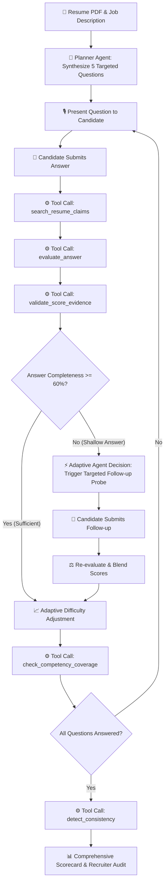

# 🤖 InterviewPilot AI — Agentic First-Round Screening Assistant
> **Autonomous, Resume-Aware, and Rubric-Anchored Technical Screening Interviewer with Human-in-the-Loop Oversight.**

[](https://python.org)
[](https://streamlit.io)
[](https://plotly.com)
[](https://pydantic.dev)
[](LICENSE)

---

## 📌 Executive Overview & Problem Statement

Traditional first-round technical screening interviews suffer from three critical bottlenecks:
1. **Generic Questionnaires:** Static question banks ignore a candidate's actual projects and specific resume claims.
2. **Lack of Adaptive Depth:** Shallow answers pass through without probing, or conversely, competent engineers get penalized by rigid scoring scripts.
3. **Score Inconsistency & Hallucination:** Different recruiters grade arbitrarily without grounding evaluations in verifiable evidence.

**InterviewPilot AI** solves this by acting as an **autonomous, agentic interviewer**. It ingests candidate resumes (PDF or raw text) and job descriptions, formulates tailored questions anchored to specific resume claims, adaptively probes incomplete answers, executes real Python evaluation tools, and generates an audit-ready scorecard with human oversight safeguards.

---

## 🌟 What Makes It Truly Agentic?

Unlike static chatbots or simple prompt wrappers, InterviewPilot AI implements a **deterministic, observable Python orchestrator loop**:



### 1. Resume-Aware Probing
The system parses specific technical accomplishments (e.g., *"reduced RAG query latency from 1.8s to 240ms"*, *"managed 25,000 req/sec on Kubernetes"*) and dynamically anchors interview questions to those claims.

### 2. Adaptive Follow-up Engine
If a candidate gives a shallow or vague response (completeness < 60%), the agent immediately intervenes with a targeted follow-up probe (e.g., asking for specific architectural metrics, failure modes, or trade-offs) before assigning a final score.

### 3. Observable Tool Execution & Activity Timeline
Every single agent decision executes real Python functions:
- `search_resume_claims()`: Cross-references claims against tech taxonomies.
- `evaluate_answer()`: Scores response against standard 1–5 rubrics.
- `validate_score_evidence()`: Verifies that assigned scores are backed by verbatim candidate quotes.
- `check_competency_coverage()`: Audits coverage across 5 core domains.
- `detect_consistency()`: Surfaces gaps between resume claims and spoken answers.

### 4. Human-in-the-Loop Safeguards
**Zero automated rejection.** The system classifies candidates into `ADVANCE TO TECHNICAL ROUND`, `HOLD / BORDERLINE`, or `NEEDS HUMAN REVIEW`. Low confidence or inconsistent findings are explicitly flagged for human recruiter follow-up.

---

## 📂 Project Architecture

```
interviewpilot-ai/
├── app.py                  # Modern Dark Navy Streamlit SaaS UI & Controllers
├── agent.py                # Agentic Orchestrator & State Management
├── tools.py                # Core Python Evaluation & Audit Tools
├── resume_parser.py        # PDF Extraction & Pydantic Claim Parser
├── report_generator.py     # Plotly Visualizations & Scorecard Generation
├── demo_data.py            # Synthetic 1-Click Resume, JD, and Test Responses
├── requirements.txt        # Minimal, lightweight dependencies
├── .env.example            # Optional LLM configuration
├── .gitignore              # Clean repository hygiene
├── README.md               # Complete documentation
└── tests/
    └── test_agent.py       # 100% Passing Automated Test Suite
```

---

## 🚀 Quickstart & Local Installation

### Prerequisites
- Python 3.10, 3.11, 3.12, 3.13, or 3.14
- pip / virtualenv

### 1. Clone & Setup Virtual Environment
```bash
# Clone the repository
git clone https://github.com/Abhinav8109/ai-hackthon.git
cd ai-hackthon/interviewpilot-ai

# Create and activate virtual environment
python3 -m venv .venv
source .venv/bin/activate  # On Windows: .venv\Scripts\activate

# Install lightweight dependencies
pip install -r requirements.txt
```

### 2. Run the Application
```bash
streamlit run app.py
```
Open your browser at `http://localhost:8501`.

---

## ⚡ Zero-Dependency 1-Click Demo Walkthrough

The project is designed to run **100% offline without any paid API keys or external services**.

1. **Load Demo:** Click the blue **"⚡ Load 1-Click Synthetic Demo"** button in the sidebar. This loads a verified senior engineer profile (*Alex Chen*) and a Senior AI Systems JD.
2. **Synthesize Agenda:** Click **"🚀 Synthesize Agentic Interview Plan"**. Notice how each generated question targets a specific claim from Alex's resume.
3. **Test Adaptive Follow-up:**
   - On Question 1, click **"⚠️ Test Shallow Answer"** and submit.
   - Watch the **Live Agent Activity Panel** record real tool calls and observe the glowing **Adaptive Follow-up Probe** appear asking for trade-offs.
   - Click **"⚡ Quick-Fill Strong Follow-up Answer"** and submit to watch the agent reward the recovery and advance.
4. **Inspect Audit Scorecard:** Navigate to the **Final Scorecard & Audit** tab to review:
   - Overall Weighted Score & Recruiter Recommendation.
   - Interactive Plotly Competency Radar Chart.
   - Question-by-question verbatim quote evidence.
   - Resume claim verification matrix.
   - One-click export to Markdown (`.md`) or Candidate Feedback letter (`.txt`).

---

## 🧪 Automated Test Suite

Run the full end-to-end verification suite:

```bash
python tests/test_agent.py
```

Expected output:
```text
==================================================
   RUNNING INTERVIEWPILOT AI VALIDATION SUITE    
==================================================
Testing Resume Parser...
✓ Parsed candidate: Alex Chen, Extracted 12 claims.

Testing Interview Planning...
✓ Successfully planned 5 resume-anchored interview questions.

Testing Adaptive Follow-up on Shallow Answer...
✓ Shallow answer correctly triggered follow-up probe: 'What key trade-offs...'

Testing Follow-up Resolution with Strong Answer...
✓ Follow-up resolved; score recovered to 5/5 and advanced to Q2.

Testing Full 5-Question Interview Flow & Final Report...
✓ Full interview completed. Overall score: 3.6/5.0 | Rec: NEEDS HUMAN REVIEW

Testing Reset Functionality...
✓ Reset verified cleanly.

==================================================
   ALL TESTS PASSED WITH 100% SUCCESS RATE!       
==================================================
```

---

## 🛡️ Responsible AI & Ethical Hiring Standards

- **No Black-Box Automated Rejection:** AI outputs are strictly decision-support recommendations for human recruiters.
- **Evidence-Grounded Scoring:** Evaluator agent must quote candidate answers directly; ungrounded scores fail validation.
- **Constructive Inconsistency Surfacing:** Resume discrepancies are categorized neutrally as *"Needs Clarification"* for the Round-2 human interviewer rather than making punitive assertions.

---

## 👥 Contributors & License
Developed for the AI Hackathon by **Abhinav** & Team.  
Licensed under the [MIT License](LICENSE).
