# 🤖 TalentPilot AI — Enterprise Agentic Technical Screening Platform
> **Autonomous, Resume-Aware, and Rubric-Anchored Technical Screening Interviewer with Relational SQLite Persistence and Human-in-the-Loop Oversight.**

[](https://python.org)
[](https://streamlit.io)
[](https://sqlite.org)
[](https://plotly.com)
[](https://pydantic.dev)
[](LICENSE)

---

## 📌 Executive Overview & Architecture

**TalentPilot AI** is an enterprise-grade AI recruitment platform combining **Use Case 1 (Shortlisted Candidate Review)** and **Use Case 4 (Agentic Technical Screening Interview)** into an automated workflow governed by strict human oversight.

### 🔑 Key Architectural Principles

1. **Strict Separation of Concerns:**
   - **Admin Portal:** Central talent command center for reviewing shortlisted profiles across 5 enterprise job roles (*Software Engineer, DevOps, AI Systems, Frontend Architect, Data Platform*), inspecting resume claims, approving candidates for Round 1, and approving final candidates for Round 2.
   - **Candidate Portal:** Fully isolated, token-authenticated candidate interview interface accessed exclusively via unique invitation links (`http://localhost:8501/?token=<secure-token>`).
2. **Complete Eradication of "Launch Interview" in Admin:**
   - The Admin Portal **never contains a "Launch Interview" button**, menu item, or direct session trigger. Admins perform only one business decision: **"Approve for First-Round Interview"**.
   - The interview can only be started independently by the candidate after receiving the invitation.
3. **Automated Pipeline Orchestration:**
   - Clicking **"Approve for First-Round Interview"** automatically validates candidate data, formulates an 8–10 tailored question plan anchored to verified resume claims, creates a cryptographically secure session token, and dispatches the official invitation email to the candidate's inbox (e.g. `sukrit.ss.31@gmail.com`).
4. **Relational SQLite Persistence:**
   - Complete schema tracking jobs, candidates, question plans, sessions, turn-by-turn Q&A responses, evaluation scorecards, notification logs, and immutable audit trails.
5. **Truth in Delivery Email Service:**
   - Real SMTP integration with TLS fallback to structured developer mock (`ACCEPTED_DEV_MOCK`). The system never falsely reports mock dispatches as real SMTP delivery.
6. **Anti-Resubmission Locks:**
   - Once an interview is submitted, the session token is locked to prevent tampering or duplicate evaluations.

---

## 🔄 End-to-End Business Workflow

```mermaid
flowchart TD
    subgraph Step1 ["Step 1: Admin Talent Review"]
        A[Admin logs into Portal] --> B[Filter candidates by Role: SE, DevOps, AI, Frontend, Data]
        B --> C[Inspect Candidate: Sukrit Sharma, sukrit.ss.31@gmail.com]
    end

    subgraph Step2 ["Step 2 & 3: Human Approval & Auto-Dispatch"]
        C --> D["Click 'Approve for First-Round Interview' (No 'Launch Interview')"]
        D --> E[Synthesize 8-10 Question Agenda]
        E --> F[Generate Cryptographic Token & Session]
        F --> G["Dispatch Invitation Email (Subject: First-Round Interview Invitation — [Job Title])"]
    end

    subgraph Step4 ["Step 4 & 5: Candidate Screening Interview"]
        G --> H["Candidate opens URL: http://localhost:8501/?token=<token>"]
        H --> I[Validate Token & Present Welcome Screen]
        I --> J[Candidate clicks 'Start Interview']
        J --> K[Conduct 8-10 Question Technical Screening]
        K --> L{Answer Completeness >= 60%?}
        L -- "No" --> M[Adaptive Follow-up Probe triggered]
        M --> N[Candidate submits recovery response]
        N --> O[Blended Scoring & Turn Persistence]
        L -- "Yes" --> O
    end

    subgraph Step6 ["Step 6 & 7: Scorecard & Final Review"]
        O --> P[All questions answered -> Final Scorecard compiled]
        P --> Q[Lock Token & Session to prevent re-submission]
        Q --> R[Admin reviews Scorecard in Completed Interviews tab]
    end

    subgraph Step8 ["Step 8: Second-Round Approval"]
        R --> S["Admin clicks 'Approve for Second Round'"]
        S --> T["Dispatch Second-Round Email (Subject: Congratulations — Selected for the Second Round)"]
    end
```



---

## 📂 Repository Layout

```
interviewpilot-ai/
├── app.py                  # High-end Dark Slate Streamlit SaaS UI (Admin & Candidate Portals)
├── database.py             # SQLite Relational Engine, Auto-seeding, and Query API
├── pipeline_manager.py     # End-to-End Recruitment Orchestration & Security Gateway
├── email_service.py        # SMTP / Mock Notification Dispatcher & Activity Tracker
├── agent.py                # 8-10 Question Adaptive Interview Agent & Tool Invoker
├── tools.py                # Deterministic Python Evaluation & Rubric Scoring Tools
├── resume_parser.py        # PDF Extraction & Pydantic Claim Parser
├── report_generator.py     # 4-Domain Scorecard Aggregations & Plotly Radar Charts
├── demo_data.py            # Synthetic Profiles, JDs, and Reference Benchmarks
├── requirements.txt        # Production Dependencies
├── README.md               # Enterprise Documentation
└── tests/
    ├── test_agent.py       # Core Agent Mechanics & Role Bucket Suite
    └── test_workflow.py    # 16-Step End-to-End Acceptance Test Suite
```

---

## 🚀 Quickstart & Local Execution

### 1. Setup Virtual Environment
```bash
cd interviewpilot-ai
python3 -m venv .venv
source .venv/bin/activate  # On Windows: .venv\Scripts\activate
pip install -r requirements.txt
```

### 2. Configure Email Service (Optional Real SMTP)
By default, the platform runs in structured developer mock mode (`ACCEPTED_DEV_MOCK`), which logs all emails with full headers and body text in the database and UI without external dependencies.

To enable live SMTP delivery (e.g. Gmail App Password):
```bash
export SMTP_HOST="smtp.gmail.com"
export SMTP_PORT="587"
export SMTP_USERNAME="your-email@gmail.com"
export SMTP_PASSWORD="your-16-char-app-password"
export SMTP_SENDER_EMAIL="your-email@gmail.com"
export SMTP_USE_TLS="true"
export APP_BASE_URL="http://localhost:8501"
```

### 3. Launch Streamlit Platform
```bash
streamlit run app.py
```
Open your browser at `http://localhost:8501`.

---

## 🧪 Automated Acceptance & Validation Test Suites

Both test suites execute 100% deterministically and offline without requiring third-party API keys.

### Run Agent Mechanics Tests
```bash
python tests/test_agent.py
```
- Validates PDF claim extraction
- Verifies 8–10 tailored question planning
- Tests adaptive follow-up triggering on shallow answers and score recovery
- Confirms 5 role buckets and token validation gateway

### Run End-to-End Workflow Acceptance Suite
```bash
python tests/test_workflow.py
```
Validates all 16 business workflow acceptance criteria:
1. Shortlisted candidate review
2. Profile and resume claim inspection
3. Admin approval for first round (verifies **absence of any "Launch Interview" button**)
4. Cryptographic invitation token and session creation
5. Automated invitation email dispatch to `sukrit.ss.31@gmail.com`
6. 8–10 question tailored agenda synthesis
7. Candidate token authentication and session initiation
8. Adaptive follow-up probing and live turn recording
9. Candidate interview submission
10. SQLite turn persistence and scorecard compilation
11. Admin review in Completed Interviews tab
12. Admin approval for second round
13. Automated second-round notification email dispatch
14. Duplicate approval prevention
15. Anti-resubmission token locking
16. Immutable audit trail logging

---

## 🛡️ Responsible AI & Evaluation Rubrics

- **Four Core Assessment Domains:**
  1. *Technical Depth & Architecture* (35% weight)
  2. *Problem Solving & Trade-offs* (30% weight)
  3. *Communication & Structured Thinking* (20% weight)
  4. *Job & Competency Alignment* (15% weight)
- **Observable Execution:** Every tool call (`search_resume_claims`, `evaluate_answer`, `validate_score_evidence`, `detect_consistency`) logs real execution parameters in SQLite and the UI timeline.
- **Human Decision Oversight:** Recommendations (`ADVANCE`, `HOLD`, `REJECT`) serve as advisory intelligence. Final hiring decisions always require human recruiter approval.

---

## 👥 Contributors & License
Developed for the AI Hackathon by **Abhinav** & Team.  
Licensed under the [MIT License](LICENSE).
